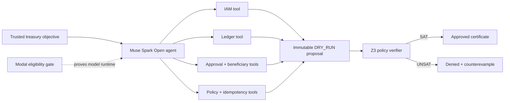

# GuardMeta Treasury

**A proof-carrying authorization agent powered by Meta Muse Spark Open.** Muse gathers controlled evidence and proposes a treasury action; GuardMeta's deterministic policy verifier—not the model—decides whether it is authorized.

Most agent demos stop after a model emits valid JSON. GuardMeta continues through the harder boundary: Who requested the transfer? Are approvals bound to this exact intent? Is the requester also an approver? Does rolling daily exposure remain legal? Every decision returns a named policy trace and a reproducible SAT/UNSAT certificate digest.

## What it does

1. **Autonomous evidence gathering** — Muse calls six controlled tool interfaces backed in this prototype by deterministic demo records representing IAM, ledger, beneficiary, approval, policy, and idempotency services.
2. **Intent-bound proposal** — Muse constructs a schema-valid `DRY_RUN` action but cannot change the trusted task envelope.
3. **Machine-checkable authorization** — Z3 checks balances, exposure, approval thresholds, beneficiary tenure, and separation of duties.
4. **Proof-carrying decision** — every result includes named checks, counterexamples, policy version, and a SHA-256 certificate digest.
5. **Defense in depth** — the original input firewall, strict schemas, bounded correction loop, and OpenAI-compatible proxy remain available.

The engine talks to **real** upstream models. There is no canned success path.

## Architecture



```text
Treasury objective → Muse Spark Open tool-calling agent
                        ├─ controlled demo IAM / ledger / approvals
                        ├─ beneficiary / idempotency / policy state
                        └─ immutable DRY_RUN proposal
                                      ↓
                              Z3 policy verifier
                        ├─ SAT   → approved + certificate
                        └─ UNSAT → denied + counterexample
```

## Quick start

```bash
python3 -m venv .venv
source .venv/bin/activate
pip install -r requirements-dev.txt
cp .env.example .env
# Put your Meta Model API token in .env as MODEL_API_KEY
uvicorn app.main:app --reload --port 8080
```

Open `http://127.0.0.1:8080` for the live console, or `http://127.0.0.1:8080/docs`.

### Make commands

```bash
make install       # create .venv and install dependencies
make dev           # hot-reloading local server
make demo          # local zero-setup scenario experience
make test          # deterministic suite, no API spend
make test-live     # one live Meta call
make check         # compile, dependency, and deterministic checks
make eval-live     # execute all fixed scenarios and save honest E2E metrics
make eval-treasury # run the live proof-agent benchmark
make modal-model   # provision the open-weight Modal Shared Endpoint
make modal-secret  # sync .env to Modal's secret store
make deploy        # deploy the public Modal endpoint
make modal-smoke   # verify production health and readiness
make modal-logs    # inspect recent production logs
```

### Environment

| Variable | Purpose |
| --- | --- |
| `MODEL_API_KEY` / `META_API_KEY` | Bearer token for Meta Model API |
| `META_BASE_URL` | Default `https://api.meta.ai/v1`. Point at vLLM / SGLang / llama.cpp for Muse Spark Open |
| `MODEL_NAME` | Default `muse-spark-1.3`. Use `muse-spark-open` when self-hosting |
| `MODEL_PROVIDER` | Infrastructure actually serving the weights (`modal`, `baseten`, `self_hosted`) |
| `REQUIRE_OPEN_WEIGHT_MODEL` | Fail closed when the runtime cannot prove open-weight eligibility |
| `UPSTREAM_OPERATIONAL_VERIFIED` | Production release gate; set true only after the live benchmark passes |
| `GUARDMETA_API_KEY` | Optional inbound key for the proxy itself |
| `FINANCIAL_MAX_AMOUNT` | Hard ceiling enforced after schema validation |
| `MAX_CORRECTION_ATTEMPTS` | Default `3` |
| `DEMO_MODE` | Enables only immutable, rate-limited public scenarios; never arbitrary public prompts |

Hosted Meta keys come from the [Model API dashboard](https://dev.meta.ai/docs/quickstart). The dashboard name is `MODEL_API_KEY`; GuardMeta accepts that or `META_API_KEY`.

### The two API keys are different

- `MODEL_API_KEY` authenticates the GuardMeta server to Meta Model API. It must remain server-side.
- `GUARDMETA_API_KEY` is an optional client access key that you choose. When configured, every client—including the browser console—must send it as `X-API-Key` or a Bearer token.

The browser cannot safely read either value from `.env`. To use the local console without entering a client key, leave `GUARDMETA_API_KEY` empty and restart the server. Keep it configured for public deployments so strangers cannot spend your credits.

## API

### Primary proof-agent flow

When `DEMO_MODE=true`, judges can run three fixed, rate-limited treasury cases without an API key:

- `GET /v1/treasury/scenarios` lists the cases.
- `POST /v1/treasury/run` accepts only a scenario ID.

The cases prove one authorized transfer and two schema-valid but unauthorized transfers: requester self-approval and rolling daily-exposure breach. All three use real Muse tool calls. Protected arbitrary-prompt APIs remain unavailable without `GUARDMETA_API_KEY`.

### Supporting guardrail flow

When `DEMO_MODE=true`, two unauthenticated but rate-limited endpoints are available:

- `GET /v1/demo/scenarios` lists immutable scenarios.
- `POST /v1/demo/run` accepts only a scenario ID.

The featured flows prove distinct control-plane behavior: approve a valid candidate without model spend, repair malformed financial, clinical, and workflow payloads with real model turns, and block an injection before inference. The arbitrary-prompt API remains protected by `GUARDMETA_API_KEY`.

### `POST /v1/guarded/execute`

```bash
curl -s http://127.0.0.1:8080/v1/guarded/execute \
  -H "Content-Type: application/json" \
  -H "X-API-Key: $GUARDMETA_API_KEY" \
  -d '{
    "schema_name": "financial_transaction",
    "prompt": "Debit 1250.50 USD from ACC-10004567 to ACC-20009876. Authorized by treasury.ops. Memo: vendor payout for invoice INV-8841. Value date 2026-10-27. Idempotency key pay-8841-a1."
  }'
```

The response includes the validated payload, attempt count, token usage, and a per-attempt trace (schema failures and repairs).

To intercept an already-generated payload, include it as `candidate`. GuardMeta validates that candidate as attempt 1 and, only when it fails, sends the compact validation errors and original task to Muse Spark for a genuine repair turn. Trace entries identify their source as `candidate` or `model`.

### `POST /v1/chat/completions`

OpenAI-compatible intercept. Send `X-GuardMeta-Schema: financial_transaction` (or `schema_name` in the body) to run the correction loop. Without a schema, prompts are still sanitized and the raw completion is scanned for secrets / PAN / SSN.

### Other

- `GET /health` — liveness
- `GET /ready` — whether an upstream key is configured
- `GET /ready` also publishes non-secret eligibility evidence: model family, serving provider, endpoint host, enforcement state, and the reason for the verdict
- `GET /v1/schemas` — registered high-risk contracts

## Tests

```bash
pytest -v
```

Deterministic tests use a scripted OpenAI-compatible client to prove firewall + retry behavior without spending API credits. They do **not** stub GuardMeta into returning success.

Live Meta call (requires `MODEL_API_KEY`):

```bash
pytest -v -m live
```

## Eligible open-weight deployment on Modal

```bash
make modal-model
# Create a Modal Proxy Token and store its joined wk-....ws-... value as
# OPEN_WEIGHT_API_KEY in the `guardmeta-open-model` Modal Secret.
make modal-secret
make deploy
make modal-smoke
make eval-live URL=https://GUARDMETA-APP.modal.run
```

`modal_app.py` forces open-weight enforcement in production. A Meta-hosted `muse-spark-1.3` configuration therefore reports unready and refuses model calls instead of being misrepresented as partner-hosted open weights.

Modal Shared Endpoints are billed per token and do not consume Modal's standard monthly compute allowance. Configure a workspace spend limit before promoting the public URL.

Current production deployment: [GuardMeta on Modal](https://yemiog--guardmeta-engine-fastapi-app.us-east.modal.run)

Production verification completed on 2026-10-28: 3/3 proof-agent cases passed with 6 Muse turns, 20 trusted tool calls, and 30 policy checks. The artifact is stored in `artifacts/treasury_evaluation.json`; the supporting five-case guardrail benchmark remains in `artifacts/evaluation.json`.

## Docker

```bash
docker build -t guardmeta .
docker run --env-file .env -p 8080:8080 guardmeta
```

